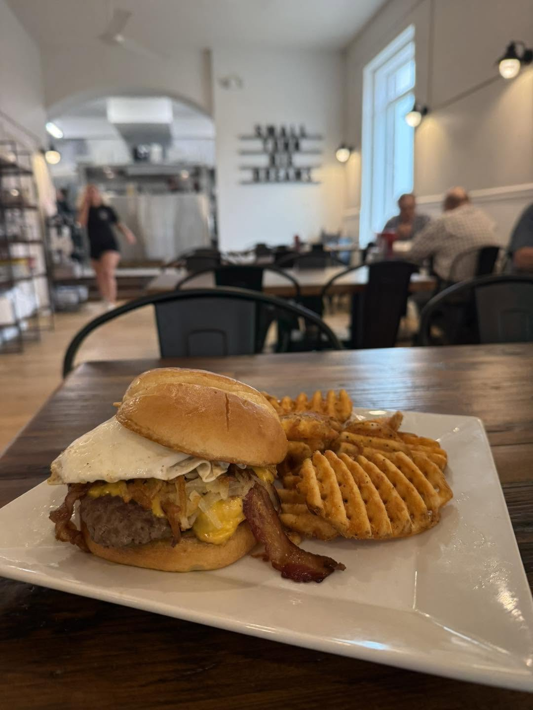
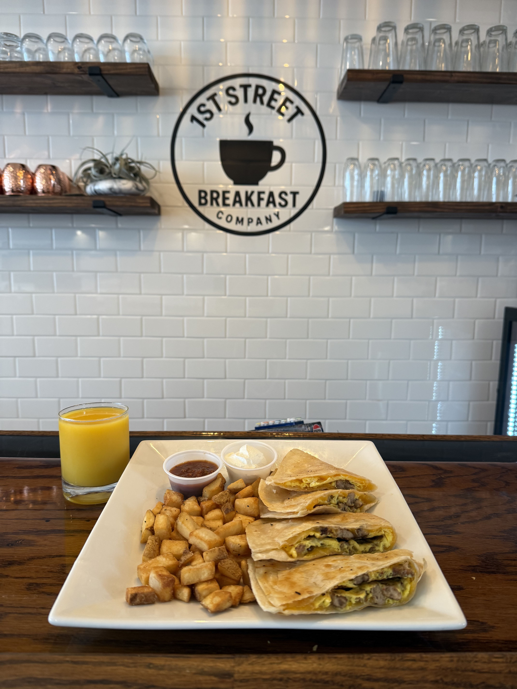

First Street Breakfast Company, which opened in Mount Vernon on June 3, marks a return of a full-service breakfast restaurant to the town after a five-year absence. The business, which is located at 100 First St., has a menu approaching classic brunch items as staple meals, and it operates out of a bright, newly renovated space. The opening fills a gap left when The Skillet Cafe, which had operated on First Street for nearly 13 years, closed in August 2021.

The owners, Michelle and Cody Rollinger, are longtime Mount Vernon residents. Both have spent decades working throughout Cedar Rapids and Marion. However, this is their first venture in ownership, and they deliberately chose to open in their restaurant in Mount Vernon. "I've worked in a restaurant basically my whole life, since I was 18" Michelle stated to *The Gazette*. Their business is run by three generations of the Rollinger family. Michelle notes that living in Mount Vernon for 20 years while working out of town means the new location is a chance to be more involved in the community.

The restaurant is open from 7 a.m. to 2 p.m. Wednesday through Monday and closed Tuesdays. Its menu highlights diner classics, such as burgers, sandwiches, salads, biscuits, and omelets, alongside options like chicken and waffles, a breakfast quesadilla, and the Ultimate Meat Burrito. Entrees average about $12. "We wanted to keep it super plain," Michelle said regarding the menu.

The opening shows more than a new restaurant. It restores a service the community had been missing since The Skillet closed, which left the town without a dedicated breakfast spot for five years. The business, which is run by three generations of the Rollinger family, can be reached at [319.305.1053](tel:3193051053) or found on Facebook. It also complements downtown's existing options, which include the Lincoln Winebar, Big's BBQ, Fuel, Chameleon's, White Tree Bakery, and Little Scratch.

This business demonstrates how Mount Vernon's commercial landscape has experienced movement within recent months. As a result, First Street Breakfast Company represents a small but recognizable addition to downtown, and it fills a niche the community had been missing. Michelle and the 1st Street Breakfast Company are so glad to have all the students back in town and hope they stop by for breakfast or lunch!

## Sources
- [Decious, E. (2026, Aug. 11). New restaurant fills needs for breakfast in Mount Vernon. The Gazette.](https://www.thegazette.com/lifestyles/food-drink/skillet-cafe-closing-in-mount-vernon/article_f8985dcf-ac93-5833-9362-e6778d369748.html)
- [Decious, E. (2021, Aug. 17). Skillet Cafe closing in Mount Vernon. The Gazette.](https://www.thegazette.com/lifestyles/food-drink/new-restaurant-fills-needs-for-breakfast-in-mount-vernon/article_740b9d58-08c1-4e72-9138-94ab1c65f968.html)
